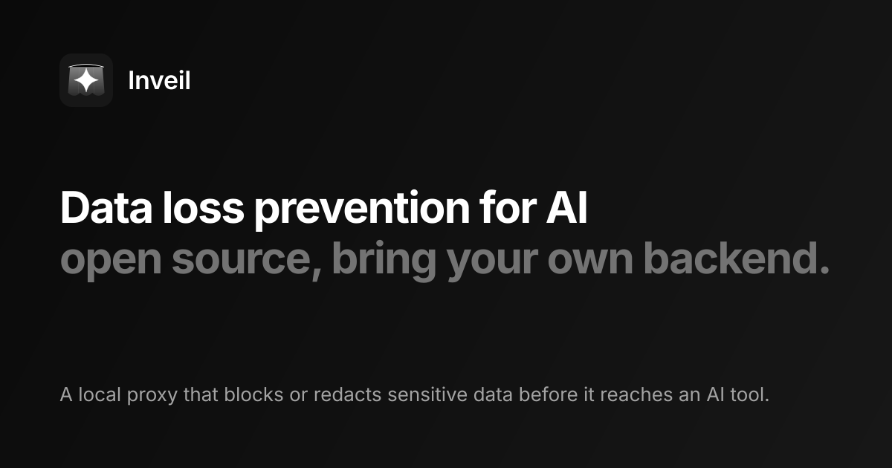

<p align="center">
  <picture>
    <source media="(prefers-color-scheme: light)" srcset="docs/assets/header-light.svg">
    
  </picture>
</p>

<p align="center">
  <a href="https://github.com/sansjack/inveil-app/actions/workflows/ci.yml"></a>
  <a href="https://github.com/sansjack/inveil-app/releases/latest"></a>
  <a href="LICENSE"></a>
  
  <!-- release-numbers: coverage badge URL -->
  <a href="https://scorecard.dev/viewer/?uri=github.com/sansjack/inveil-app"></a>
  <a href="#verify-a-download"></a>
  <a href="CONTRIBUTING.md"></a>
</p>

> [!WARNING]
> **Alpha software.** This repo is still in alpha. The detector engine is less than 10% complete and will be refactored, so do not rely on Inveil to catch sensitive data yet. Expect breaking changes.

Inveil is a local proxy that sits between your AI tools and their providers. It reads the chat requests those tools send, looks for sensitive data (card numbers, national ids, IBANs and anything you add), and blocks or redacts it before the request leaves your machine.

It is open source and does not come with a hosted service. You bring your own backend: the smallest one is a signed JSON file on a static web server.

> Status: pre-1.0. The contract, configuration and CLI can still change in minor releases. Items marked "planned" are not built yet.

## What it does

- Scans requests from AI tools (an API proxy on localhost, plus a browser proxy for web chat) and blocks, redacts or only logs each finding according to signed rules.
- Reads only the chat endpoints named in the rules. Everything else is forwarded untouched.
- Never sends prompt content anywhere except to the AI provider you were already using. At most it reports usage metadata (model, token counts, latency, blocked or not), and only if configured.
- Takes its rules and policy settings from a backend you control, verifies them with Ed25519 signatures against keys you pin locally, and refuses anything unsigned, expired or rolled back.

<!-- release-numbers: demo recording (scripts/demo.sh) -->

## How it works

<p align="center">
  
</p>

For every request the proxy runs five steps: route (is this a chat endpoint for a configured tool?), decode (decompress, parse JSON, form, protobuf or a streaming frame), detect (run the signed rules and the local deny list), decide (apply the effective settings), then forward, redact or block. See [docs/ARCHITECTURE.md](docs/ARCHITECTURE.md).

What leaves the machine:

| Direction | What | When |
|---|---|---|
| In | Signed rules snapshot | Polled from your backend, or read from a local file |
| In | Update manifest | Only if `update.mode` is not `off` |
| Out | Usage metadata and heartbeats, never content | Only if `usage.sink` is `http`, or the signed settings require it. Enrolled and managed clients send heartbeats unless the signed settings disable usage |
| Out | The original or redacted request | To the AI provider, as before |

### Failure behaviour

| Situation | Behaviour |
|---|---|
| Request cannot be scanned (`failure_modes.unscannable`) | Blocked by default; passed and audited if the signed policy says `open` |
| Scanner fails internally (`failure_modes.scan_error`) | Blocked by default; passed and audited if the signed policy says `open` |
| Rules signature invalid, unknown schema, lower version or wrong audience | Snapshot rejected; the last good snapshot stays in use |
| Rules expired with no fresh snapshot (`failure_modes.policy_expired`) | Chat traffic blocked by default; with `open` the last good snapshot keeps being used and every request is audited as `fail_open` |
| Local `upstream` not in the signed `allowed_upstreams` | Refused |
| Local setting looser than the signed setting | The stricter value wins |
| inveil not running, browser sites (`failure_modes.service_down`) | Traffic goes direct by default; `closed` (locally `browser_fail_closed = true`, or from the backend) makes the sites unreachable |

Every pass-through caused by an `open` mode is written to the audit log with `"action":"fail_open"` and its `condition`, and counted in the usage heartbeat. See [docs/CONFIGURATION.md](docs/CONFIGURATION.md#failure-modes). The browser route going direct while inveil is down is an availability trade-off. See [docs/THREAT_MODEL.md](docs/THREAT_MODEL.md) for the honest limits.

## Quick start

Install on macOS or Linux with the `install.sh` attached to each release (Windows uses `install.ps1`, run as a script block so it can take parameters; see its header). The release copy has the update public keys and the minimum signature count (2) filled in; the script in `scripts/` is the template. `--no-enroll` skips organisation enrollment, which a standalone setup does not need:

```sh
curl -fsSL https://github.com/sansjack/inveil-app/releases/latest/download/install.sh | sh -s -- --no-enroll
```

What the script checks, in this order, before it runs anything it downloaded: the signed manifest's Ed25519 signatures (verified by OpenSSL 3, not by the downloaded binary) must come from at least two distinct pinned keys; the manifest must be unexpired, for the right channel and not older than what is installed; then the binary's SHA-256 and size must match the signed manifest. Only then does `inveil verify` run as a second check.

Limits: the pinned keys travel inside the script, so `curl | sh` is only as trustworthy as the origin and TLS connection serving it; compare the key fingerprints it prints with the release notes. Stock macOS has LibreSSL, which cannot verify Ed25519: install `openssl@3` with Homebrew or the script refuses to install. On Windows the script needs an OpenSSL 3 binary (Git for Windows ships one) for the same reason. To verify by hand instead, follow [Verify a download](#verify-a-download). Organisation enrollment is in [docs/ENROLLMENT.md](docs/ENROLLMENT.md); the enrollment token is passed in the `INVEIL_ENROLL_TOKEN` environment variable, never on the command line.

Create a config and run the proxy. inveil never reads a configuration file just because it sits in the current directory (a cloned repository could otherwise set your trust roots), so pass the file you reviewed with `--config`, or move it to the per-user data directory to make it the default:

```sh
inveil init
inveil --config inveil.toml run
```

Point your tool at the proxy. For Claude Code:

```sh
export ANTHROPIC_BASE_URL=http://127.0.0.1:8787
```

To keep the proxy running in the background and point local tools at it, run `inveil install`. To let the browser proxy read AI chat sites, run `inveil browser-setup`. `inveil doctor` then says, for each enabled tool, whether it is covered; what each tool needs is in [docs/SUPPORTED_TOOLS.md](docs/SUPPORTED_TOOLS.md).

```sh
inveil doctor            # Covered, Needs setup or Not covered per tool; exits 1 if any is Not covered
inveil doctor --json
inveil refetch           # fetch your organisation's latest rules now (restarts the background service)
sudo inveil install --managed # only Claude Code's machine-wide managed settings (needs admin rights); then run `inveil install` as your own user
inveil discover claude.ai --record   # developers: record hosts, paths and content types, never bodies
```

Check that it works with a fake SSN. A blocked request returns HTTP 400:

```sh
curl -s -o /dev/null -w "%{http_code}\n" http://127.0.0.1:8787/v1/messages \
  -H "content-type: application/json" \
  -d '{"model":"test","max_tokens":1,"messages":[{"role":"user","content":"my ssn is 123-45-6789"}]}'
```

This needs an enabled rule with the `ssn` validator and the `block` action. With no backend configured, `inveil run` uses the built-in rules and says so.

## Bring your own backend

A backend is any server that implements contract v1:

- `GET /v1/rules` returns a signed envelope `{ payload, signatures }`. The payload is a JSON string (rules, tools, settings, expiry) signed with Ed25519 under a domain-separated prefix. The ETag is the SHA-256 of the payload; 304 is supported but optional.
- `POST /v1/usage` (optional) accepts batches of at most 100 metadata events.
- `POST /v1/enroll` (optional) exchanges an enrollment token for a device credential.
- The client pins the public key locally and verifies the signature before it parses the payload.

Start with [docs/SELF_HOSTING.md](docs/SELF_HOSTING.md): a working backend in five minutes with `inveil keygen`, `inveil sign` and a static file server, no code. The full reference is [docs/CONTRACT.md](docs/CONTRACT.md) and [contract/v1/openapi.yaml](contract/v1/openapi.yaml). Organisation onboarding is in [docs/ENROLLMENT.md](docs/ENROLLMENT.md).

## Solo, Team, MDM, offline

| Shape | Who decides | Backend needed |
|---|---|---|
| Solo (`standalone`, the default, no `backend.url`) | You. All settings, including usage reporting, are local. | No |
| Team (enrolled through an invite) | The organisation, through signed settings. Local `dry_run = true` and `open` failure modes are ignored, with a warning at startup. The trust anchors (`backend.url`, pinned and root keys) stay local. Usage reporting follows the signed `usage_reporting`: with `optional` the client still sends heartbeats, with `disabled` nothing. | Yes |
| MDM (`mode = "managed"` in the system-wide file) | An administrator, through signed settings and a configuration standard users cannot edit. A local `open` failure mode is refused at startup. Usage reporting can be required, optional or disabled. | Yes, or a signed file |
| `offline = true` | Nothing is fetched or sent. Rules come from `rules_file` or the built-in set. For Team and MDM clients this is ignored unless the signed settings allow it. | No |

A local administrator can always replace the binary or stop the service. Team and MDM raise the bar and give the backend a way to detect drift (heartbeats carry the policy version and a configuration hash); it does not prevent tampering. See [docs/THREAT_MODEL.md](docs/THREAT_MODEL.md).

## Configuration

Layering, highest first: flags, `INVEIL_*` environment variables, `inveil.toml` (the per-user file or the one named by `--config`; never one found in the current directory), defaults. Unknown keys are rejected. The annotated file is [examples/inveil.toml](examples/inveil.toml); the full reference is [docs/CONFIGURATION.md](docs/CONFIGURATION.md).

| Key | Default | Related server-enforced setting |
|---|---|---|
| `mode` | `standalone` | none |
| `offline` | `false` | `allow_offline` |
| `rules_file` | unset | none |
| `backend.url` | unset (built-in rules) | none (trust root, local only) |
| `backend.rules_path` | `/v1/rules` | none |
| `backend.enroll_path` | `/v1/enroll` | none |
| `backend.poll_minutes` | `30` | `min_poll_seconds` |
| `backend.pinned_keys` | `[]` | none (trust root, local only) |
| `backend.root_keys` | `[]` | none (trust root, local only) |
| `backend.allow_insecure_http` | `false` | none |
| `auth.mode` | `none` | none |
| `auth.token_env` | unset (OS keychain) | none |
| `auth.device_flow.client_id` | `inveil-client` | none |
| `auth.device_flow.code_path` | `/api/auth/device/code` | none |
| `auth.device_flow.token_path` | `/api/auth/device/token` | none |
| `auth.device_flow.session_path` | `/api/auth/get-session` | none |
| `auth.device_flow.jwt_path` | `/api/auth/token` | none |
| `listen.port` | `8787` | none |
| `listen.browser_port` | `8788` | none |
| `limits.max_body_bytes` | `33554432` (32 MiB) | none |
| `limits.max_decoded_bytes` | `67108864` (64 MiB) | none |
| `upstream` | `https://api.anthropic.com` | `allowed_upstreams` |
| `dry_run` | `false` | `dry_run` |
| `block_unscannable` | unset (alias for `failure_modes.unscannable`: `true` closed, `false` open for Solo) | `failure_modes.unscannable` |
| `failure_modes.*` | unset (`open` or `closed` for Solo, only `closed` for Team and MDM) | `failure_modes` |
| `deny` | `[]` | `deny` (union) |
| `max_tokens` | `0` (no limit) | `max_tokens` (lowest non-zero) |
| `browser_fail_closed` | unset (alias for `failure_modes.service_down`: `true` closed, `false` open) | `failure_modes.service_down` |
| `notify` | `true` | none |
| `usage.sink` | `none` | `usage_reporting`, `heartbeat_seconds` |
| `usage.path` | `/v1/usage` | none |
| `usage.file` | unset | none |
| `logging.level` | unset | none |
| `logging.debug`, `logging.trace` | `false` | `allow_debug` |
| `logging.file`, `logging.audit_file` | unset | none |
| `update.mode` | `notify` | `min_client_version` |
| `update.feed_url` | unset (required for any `update.mode` other than `off`) | none |
| `update.channel` | `stable` | none |
| `update.check_hours` | `24` | none |
| `update.pinned_keys` | `[]` | none |
| `data_dir` | unset (per-user directory) | none |

The signed `block_unscannable`, `browser_fail_closed` and `fail_closed_on_expiry` flags are legacy: they still work when `failure_modes` is silent about the condition. Local configuration can only make an enforced setting stricter, never looser (a failure mode is the exception for Solo: the owner may open it locally unless the signed policy sets it; a Team device ignores a local `open` with a startup warning, and MDM refuses it at startup).

## Security

- The client trusts only keys pinned in local configuration. Whoever hosts the files (backend, CDN, GitHub) is untrusted for integrity.
- Three key roles with separate signing domains: update key (binaries), policy key (rules), optional root key (delegates short-lived policy keys). A rules signature never verifies as an update signature.
- Signatures are checked before anything is parsed. Versions only go up, snapshots expire, and a snapshot for another organisation is rejected.
- Updates download only raw binaries named in a signed manifest, check the SHA-256 before and after installing, and roll back if the new version does not start.
- Read [docs/THREAT_MODEL.md](docs/THREAT_MODEL.md) for what this does not protect against, and [SECURITY.md](SECURITY.md) to report a vulnerability privately.

### Verify a download

Each release publishes `SHA256SUMS`, the signed manifest envelope `update-manifest.json.sig` (this is also what `update.feed_url` must point at; the unsigned payload is never published), build provenance and an SBOM. `SHA256SUMS` comes from the same origin as the binaries, so it detects corruption, not a compromised origin. The signed manifest and the attestation are the integrity evidence. From a directory containing the downloaded files:

```sh
gh attestation verify <downloaded-file> -R sansjack/inveil-app
sha256sum -c SHA256SUMS --ignore-missing      # macOS: shasum -a 256 -c SHA256SUMS --ignore-missing
```

To check the manifest signatures without running the download, use the pinned keys from the release notes ([docs/RELEASING.md](docs/RELEASING.md)) and `install.sh`, which does exactly that with OpenSSL. `inveil verify --role update --pinned-key <id>=<base64> ... --artifact <binary> update-manifest.json.sig` does the same check, but it is the binary under test: run it only once the attestation or `install.sh` has passed, never as the first check.

## Supported platforms

| OS | Architectures | API proxy | Browser proxy | Service install | Auto-update |
|---|---|---|---|---|---|
| macOS | aarch64, x86_64 | yes | yes | launchd | yes |
| Windows | x86_64, aarch64 | yes | yes | Scheduled Task | yes |
| Linux (glibc) | x86_64, aarch64 | yes | Chromium-based browsers (NSS database, `.pki/nssdb`) and GNOME or KDE proxy auto-config (gsettings, kwriteconfig); Firefox is planned | systemd user unit | yes |

CI runs on all three operating systems. On Linux, `inveil browser-setup` needs `certutil` (`libnss3-tools`) and `gsettings` or `kwriteconfig`; it prints what is missing. See [docs/SUPPORTED_TOOLS.md](docs/SUPPORTED_TOOLS.md).

## Build and test

Requires the Rust toolchain pinned in [rust-toolchain.toml](rust-toolchain.toml).

```sh
cargo build --release
cargo test --workspace
cargo test --workspace -- --ignored   # end-to-end tests that install into a temporary HOME
cargo bench                           # scan throughput and added latency
cargo llvm-cov --workspace            # coverage
(cd crates/engine && cargo fuzz run <target>)   # parser and verifier fuzz targets
```

Platform notes and how to add a detector are in [CONTRIBUTING.md](CONTRIBUTING.md).

## Project health

Numbers are filled in at release time, not hand-edited between releases.

| Item | Value |
|---|---|
| Latest release artifacts (size, SHA-256) | <!-- release-numbers: artifact table --> pending first release |
| Scan throughput, 64 KiB request | <!-- release-numbers: benchmark MB/s --> pending |
| Scan throughput, 1 MiB request | <!-- release-numbers: benchmark MB/s --> pending |
| Added latency p50 / p99 | <!-- release-numbers: benchmark latency --> pending |
| Line coverage | <!-- release-numbers: coverage --> pending |
| Minimum supported Rust version | 1.89 |
| `cargo deny` status | see the CI badge |
| SBOM | attached to each release |

## Roadmap

Tracked as GitHub issues. Open items, with no dates:

- Redact-first mode for blocked requests. Today a blocked message stays in the tool's conversation history until the user rewinds.
- Behaviour behind TLS-inspecting corporate proxies and PAC settings.
- A prompt-injection detector.
- An ML-based detector behind the `Detector` trait.
- An optional server-side scanning mode.
- Firefox CA trust on Linux.
- mTLS to the backend.

## Contributing

Contributions are welcome. Start with [CONTRIBUTING.md](CONTRIBUTING.md) and the [Code of Conduct](CODE_OF_CONDUCT.md). Project decisions are described in [GOVERNANCE.md](GOVERNANCE.md); questions go through [SUPPORT.md](SUPPORT.md). Release history is in [CHANGELOG.md](CHANGELOG.md).

## Licence

Code is licensed under [Apache-2.0](LICENSE). The Inveil name and logo are not licensed for use by forks; see [TRADEMARKS.md](TRADEMARKS.md).
