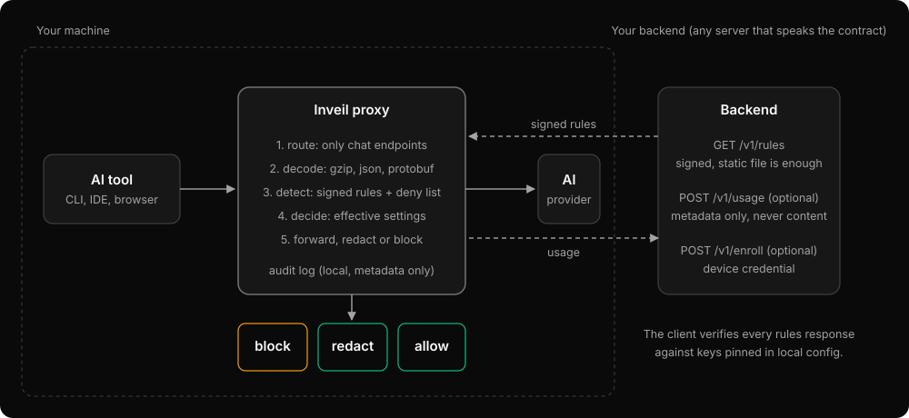

# Architecture

Inveil is a Rust workspace of three crates. The split keeps decisions testable without a network, a disk or an operating system.

| Crate | Contains | Does not contain |
|---|---|---|
| [`contract`](../crates/contract) | Serde types for everything exchanged with a backend: signed envelope, rules snapshot, settings, usage batch, enrollment, update manifest. | I/O, verification |
| [`engine`](../crates/engine) | Scanning, detectors, policy evaluation, signature verification, decoding, protobuf. | Network, disk, OS calls |
| [`inveil`](../crates/inveil) | The binary: CLI, configuration, the two proxies, backend adapters, authentication, platform layer, updater. | Policy decisions |

## Request pipeline

Each stage is a plain function that can be unit tested without a server.

1. Route. The request is matched against the chat endpoints of the enabled tools in the signed snapshot. Anything else is forwarded untouched and never read. Hosts are compared in lower case without a trailing dot. Exact routes are case-sensitive and exact: a path that differs from one only by case or a trailing slash, or that has dot segments, percent-encoding, `//`, `;` or `\`, is refused with a `400` and an audit entry (`rejected`) instead of being forwarded, because the upstream might fold it onto the chat route. Plain GET, HEAD and OPTIONS requests to a browser-proxied host are exempt from that check unless they are WebSocket upgrades, so pages with percent-encoded asset names keep loading.
2. Decode. Decompress (with a size cap), then parse the body as JSON, form data, protobuf, framed protobuf, a WebSocket JSON frame or a streaming Connect/gRPC-web frame.
3. Detect. Every `Detector` runs over the extracted text and returns findings. A finding carries the rule id, a location, a per-process salted hash (so repeats can be correlated without storing the secret) and the rule's action.
4. Decide. Findings and the effective settings produce a typed decision: allow, redact or block. Effective settings are the local configuration merged with the signed `settings`, stricter value wins.
5. Forward, redact or block. Redaction rewrites the matched spans. A block returns an error to the tool. Either way a metadata-only audit entry and usage event are produced.

Content is never logged. Debug and trace logging record metadata only.

## Two proxies

- API proxy on `127.0.0.1:<listen.port>`. A tool is pointed at it with a base-URL environment variable (for example `ANTHROPIC_BASE_URL`, taken from the tool's `env_var` in the snapshot). It forwards to the tool's `upstream`. It accepts only loopback `Host` headers and rejects requests that carry an `Origin`, so a web page cannot use it, including through DNS rebinding. Before routing, the request path is checked once and refused with 400 (and an audit line) if it contains dot segments, any `%` escape, `//`, `;` or a backslash, so the string that is matched against the chat routes is exactly the string forwarded and the upstream cannot resolve it to a different route. Hop-by-hop headers are stripped in both directions. The same listener serves `/proxy.pac` and `GET /health` (the program version and the active policy version only).
- Browser proxy on `127.0.0.1:<listen.browser_port>`. Browsers reach it through the PAC file, which is served by the API proxy on `<listen.port>`. It decrypts only the hosts listed in the snapshot, using a local CA whose X.509 Name Constraints cover only the snapshot's `ca_domains`. Everything else is tunnelled without inspection. It is not an open proxy: CONNECT is accepted only to port 443 of hosts the catalog names (or under a CA domain), and a plain request is accepted only as `https` to a decrypted host whose `Host` header matches. Host names are compared in lower case with one trailing dot ignored (`CLAUDE.AI:443` and `chatgpt.com.:443` are intercepted), and the PAC script matches the same way, because browsers keep the trailing dot of `https://chatgpt.com./`. `inveil discover` applies the same guard.

## Ports and adapters

Traits exist only where there is more than one real implementation.

| Port | Implementations | Reason |
|---|---|---|
| `PolicySource` | HTTP backend; local file | Self-hosters may only want a static signed file; air-gapped use |
| `UsageSink` | HTTP backend; JSONL file; none | Bring your own metrics |
| `CredentialProvider` | none; static bearer; enrolled device credential; OAuth device flow | Bring your own auth |
| `Detector` | signed-rule regex with validator; local deny list | The extension point for contributors |

`PolicySource`, `UsageSink` and `CredentialProvider` live in [`crates/inveil/src/backend.rs`](../crates/inveil/src/backend.rs). `Detector` is in [`crates/engine/src/detector.rs`](../crates/engine/src/detector.rs).

## Platform layer

[`crates/inveil/src/platform`](../crates/inveil/src/platform) is the only code that touches the operating system: service registration (launchd, systemd user unit, Scheduled Task), trusting the browser CA for the current user, the system PAC setting, notifications and per-user directories. One implementation per OS behind `cfg`, one set of function signatures for the rest of the program. Anything that builds a command line or script from data passes it as arguments, never by string interpolation.

### Runtime trust and `inveil doctor`

[`platform/runtime_trust.rs`](../crates/inveil/src/platform/runtime_trust.rs) holds the one table of runtimes and how each learns about the browser CA, and a pure function that returns the environment for one process of a runtime. Variables are scoped to that process; nothing is set globally. [`cli/doctor.rs`](../crates/inveil/src/cli/doctor.rs) gathers facts (listeners, CA, trust store, PAC, where each base URL is set) once and judges every enabled catalog tool from them, so the verdicts are testable without a machine. `inveil discover` ([`cli/discover.rs`](../crates/inveil/src/cli/discover.rs)) is a separate, opt-in recording proxy for developers. The supported tools are listed in [SUPPORTED_TOOLS.md](SUPPORTED_TOOLS.md).

## State

State lives in the per-user data directory (override with `data_dir`): the cached last good snapshot, the high-water mark and revoked key ids for snapshots, the newest release and revoked key ids for the updater, the browser CA, and logs. The anti-rollback files carry a counter that is mirrored in the OS keychain (`state_keychain`), which also holds the device credential and the organisation id from enrollment. The shared store is [`trust_state.rs`](../crates/inveil/src/trust_state.rs).

## Where policy comes from

See [CONTRACT.md](CONTRACT.md) for the wire format and [THREAT_MODEL.md](THREAT_MODEL.md) for what is trusted. In short: a signed snapshot arrives from the backend (or a file), is verified against locally pinned keys before parsing, checked for expiry, audience and version, then merged with local configuration.
