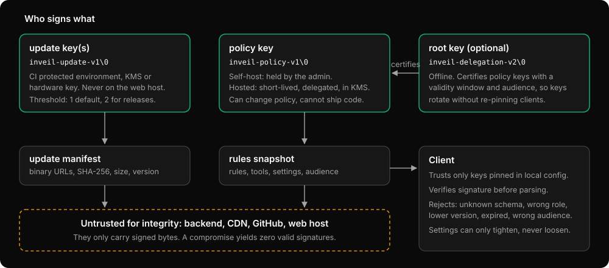

# Threat model

Inveil is a detection and prevention aid for accidental data disclosure to AI tools. It is not a defence against a determined insider with local administrator rights. This page states what it does and does not protect against.

## Assets and trust

- Prompt content stays on the machine unless it is sent to the AI provider the user already chose; Inveil never copies it elsewhere.
- Policy integrity: the rules and settings the client enforces.
- Binary integrity: the code that runs as the user.

Principle: whoever hosts the files (backend, CDN, web host, GitHub) is untrusted for integrity. The client trusts only keys pinned in local configuration. Every pushed artefact is signed by a key that is not on the serving machine.

| Key | Signs | Compromise means |
|---|---|---|
| Update key(s) | Update manifests (binary hashes) | Can ship a malicious binary. Highest value; held in a protected CI environment or KMS plus a hardware key, with a signature threshold. |
| Policy key | Rules snapshots, including `settings` | Can weaken policy; cannot ship code. |
| Root key (optional, hosted) | Delegations of short-lived policy keys | Can mint policy keys. Kept offline. |

Domain separation (`inveil-policy-v1\0`, `inveil-update-v1\0`, `inveil-delegation-v2\0`) stops a signature for one role verifying as another.

## What it defends against

- A compromised or malicious backend, CDN or file host serving altered rules: the signature fails, the snapshot is ignored.
- Replay of an old valid snapshot or manifest: versions are monotonic with a persisted high-water mark, same-version-different-content is refused, and snapshots expire.
- Cross-organisation replay: a snapshot's `audience` must match the organisation recorded at enrollment (`org_id` from the enroll response, kept in the OS keychain), and a key delegated for one audience cannot sign a snapshot for another. A client enrolled without an `org_id` has no audience binding.
- A signer lowering the bar: the update threshold is `max(manifest, update.min_signatures)` with `min_signatures` pinned locally (it defaults to 2 whenever two or more distinct update keys are pinned, 1 for a single key), signers are counted by public key, and a payload can revoke keys only if it still meets the full requirement without them.
- A tampered update: manifest signature, size, SHA-256 before and after install, no archive parsing, a smoke test of the binary before install, and rollback if the new binary does not come up healthy.
- Falling back to the built-in rules: when pinned keys are configured, a cache that is missing, unreadable or unverifiable stops the start with a message instead of running with default settings. The one exception is the first start before any snapshot was ever accepted (in managed mode the policy then counts as expired, so the `policy_expired` failure mode applies).
- A web page using the local proxy, including DNS rebinding: the API proxy requires a loopback `Host` for its own port and rejects any request carrying an `Origin`. This does not stop another local process: a program running as the same user can send `Host: 127.0.0.1:<port>` with no `Origin` and is served like any tool (the same-user model; see below).
- A request routed one way and forwarded another: the API proxy matches chat routes on the raw path, so a path the upstream could rewrite (`/v1/x/../messages`, `%2e%2e`, `%2f`, `//`, `;` parameters, backslash, or any other `%` escape) is refused with 400 and an audit line instead of being interpreted. The browser proxy applies the same check to POSTs to decrypted hosts.
- The browser proxy used as an open proxy: CONNECT is limited to port 443 on hosts the catalog names or the CA covers, and plain requests must be `https` to a decrypted host with a matching `Host` header. Browsers legitimately send `Origin` on cross-origin requests to the sites themselves, so `Origin` cannot be rejected there.
- Editing configuration to exfiltrate credentials via a different upstream: `allowed_upstreams` from signed settings, https-only upstreams.
- Local weakening of server-enforced settings: the merge can only tighten.
- A leaked browser CA key impersonating arbitrary sites: Name Constraints limit it to the snapshot's `ca_domains`.

### Local state

The anti-rollback state (the snapshot high-water mark and revoked key ids, the newest release seen) lives in the user-writable data directory, so each file carries a counter and a MAC under a random key that exists only in the OS keychain, next to the counter and a digest of the file. A file is accepted only if it is exactly the record the keychain describes, or the next one (a crash between writing the file and the keychain) *and* its MAC verifies; a file that is missing, older, different, or merely claims a higher counter is refused. An attacker who can write the data directory but not the keychain can therefore neither roll back nor forge state. When the keychain is unreadable the client logs `state_protection="file_only"` and the file protects itself alone; records written in that state carry no MAC, and if the keychain later returns with a record that has only seen older ones, the unauthenticated newer file is refused with instructions to reset. Files are written atomically with fsync and unique temporary names. Limits: a user who can delete the keychain item as well as roll the file back defeats this, and where no keychain exists (a headless Linux box) only the file protects itself. A root-owned anchor outside the user's reach for managed installs needs a platform data directory that the service can write and the user cannot; until that exists, managed installs rely on the keychain.

## What it does not defend against

### A local administrator

Anyone with administrator rights on the machine can stop the service, run a modified binary, edit the system-wide configuration, remove the CA or change the PAC setting. Managed mode (MDM) raises the bar and gives detection, not prevention. A Team device, enrolled without a system-wide file, gets the signed settings and the heartbeat but not the administrator-only configuration, so a local administrator or user can still edit the per-user file and the unsigned keys in it. That includes the trust anchors: a Team device's `backend.url`, pinned keys and `[update]` keys live in the user-editable per-user file, and only MDM locks them in the system-wide file:

1. Managed configuration lives in the system-wide location, writable only by administrators, and wins over the per-user file.
2. Enforced settings arrive signed, so a user or a compromised backend cannot forge `usage_reporting = "disabled"`.
3. Detection: heartbeats carry the client version, policy version and a hash of the effective configuration. The backend can flag devices that go silent or report a different hash than the policy it published.
4. Hard stop: the `policy_expired` failure mode is `closed` unless the signed policy opens it, so with a short snapshot `expires_at` a device cut off from the backend stops being allowed to send chat traffic. This also blocks a device that merely has no network, so choose `expires_at` deliberately.

### Offline and suppression

`offline = true` removes all network use. On an enrolled or managed client it is ignored unless the signed settings set `allow_offline`. A user who can edit the system-wide configuration, or who cuts the device off from the backend while the signed `policy_expired` mode is `open`, can run on the last good snapshot until it expires and beyond. The layers above reduce this; none of them eliminates it.

### Another local process

The localhost guard separates web pages from the proxy; it does not separate local programs. Any process that can open a TCP connection to `127.0.0.1` can send `Host: 127.0.0.1:<port>` with no `Origin` and use the API proxy, whose upstream requests carry whatever credentials the caller supplies (the proxy adds none). On a multi-user machine other users' processes can reach the same ports. The model is one user per machine session; use a dedicated machine or account if that is not acceptable.

### Detection is not prevention

Detectors are regular expressions with checksum validators, so they miss anything they have no pattern for and can produce false positives. Content split across messages, encoded or encrypted by the tool, or sent through a route that is not a configured chat endpoint is not seen. On the API proxy a request to a path that is not a listed chat route is streamed through unread by design, including a POST body to a host that also has chat routes, so a tool or a person who can choose an unlisted path can send content unscanned; the catalog is how new chat routes are covered. A path that is only a case or trailing-slash variant of a listed exact route is not treated as unlisted: it is refused with a `400`. Traffic from tools that are not pointed at the proxy and are not caught by the browser proxy is not inspected. When inveil is not running, the browser PAC falls back to a direct connection by default (`service_down` is `open`, for availability); set `failure_modes.service_down` to `closed` to make the chat sites unreachable instead. That mode is applied by the routing that is written, so it works even though a stopped process cannot enforce anything, and the PAC is only re-read by the browser from a running proxy: a PAC the browser already cached keeps its old fallback. Traffic passed because an in-process mode (`unscannable`, `scan_error`, `policy_expired`) is `open` is not scanned; it is written to the audit log as `fail_open` and counted in the heartbeat, so a policy that opens these modes is visible, not silent. In managed mode only the signed policy can open a mode and local configuration can only close one (a local `open` is refused at startup). A Team (enrolled) device ignores a local `open` with a warning at startup and keeps starting. In standalone mode without enrollment (Solo) the owner may open modes locally, which is their own decision about their own machine, and a signed value for the same condition still wins. Claude Code has no fail-open path for a stopped service yet: its route stays closed.

### Blocked messages and history

When a request is blocked, the tool keeps the message in its conversation history and may resend it. A redact-first option is on the roadmap.

### curl | sh

The install script verifies the signed update manifest with OpenSSL 3 (Ed25519, domain-separated) before it executes anything, counts distinct pinned keys against a pinned minimum, and then checks the binary's hash and size against the signed entry. `SHA256SUMS` comes from the same origin as the binaries, so it detects corruption only. The keys embedded in the script are the trust root: a compromised host serving `install.sh` can serve a script with its own keys and still defeats it. The script prints the key fingerprints; compare them with the release notes out of band. Other mitigations are the manual route (`gh attestation verify`, then `inveil enroll --bundle`) and MDM or package deployment.

### The local CA

The browser proxy relies on a CA trusted for the current user, constrained to AI vendor domains. The private key is stored in the data directory with restricted permissions; a process running as the same user can read it. Firefox and some Linux NSS stores may not enforce Name Constraints the way system stores do. Multi-user machines: the proxy listens on loopback, which other local users can reach.

### Supply chain

The binary, its dependencies and the build are in scope for the project, not for this page's guarantees. Releases carry provenance attestations, an SBOM and `cargo deny` and `cargo audit` checks. See [RELEASING.md](RELEASING.md) and [SECURITY.md](../SECURITY.md).

## Reporting

Report vulnerabilities privately as described in [SECURITY.md](../SECURITY.md).

## Residual risks

Known weaker points, stated plainly. Each is a limit of the current implementation or design, not a bug being hidden.

**R1. Managed mode is not tamper-proof against the local user or admin.** The system-wide configuration is writable only by administrators, but the service, the data directory and the keychain anchor of the anti-rollback state are per-user. A user can stop the service, and `failure_modes.service_down` defaults to open, so traffic then flows unscanned (the browser PAC falls back to `DIRECT`; the managed Claude environment variable points at a dead port, which fails closed for that tool only). Real protection needs a service and data directory owned by root or SYSTEM, which is not built yet. Until then managed mode gives detection through heartbeats, not prevention.

**R2. Rollback protection falls back to the file alone without a keychain.** The high-water marks for snapshots and update manifests are mirrored in the OS keychain. On headless Linux with no secret service, with `state_keychain = false`, and when the keychain returns an error, the anchor is missing and only the state file protects against rollback. Anyone who can restore an older file in the data directory can then replay an older validly signed snapshot or manifest.

**R3. 2-of-N is only as independent as key custody.** The installers and the updater count distinct signing keys. If one person, one laptop or one CI account can use both, the threshold gives no extra protection. The co-signer must verify the binary hashes independently, by a reproducible build or `gh attestation verify`, before signing; signing what CI reports is a rubber stamp. Official releases keep only one update key in CI for this reason.

**R4. The installer's trust root is the script itself.** The pinned keys live in `install.sh` and `install.ps1`, so compromising the host that serves them is equivalent to compromising the keys. Both scripts need OpenSSL 3 to check Ed25519 signatures, which Windows and stock macOS (LibreSSL) do not ship, and refuse to install without it. They do not evaluate `revoked_key_ids`; only the in-app updater does. Compare the printed key fingerprints with the release notes.

**R5. Replay on a fresh install within the manifest's validity.** The installers check expiry with the local clock only. With nothing installed there is no version to compare with, so an older signed manifest that has not expired is accepted. Use `--min-version` / `-MinVersion` with the newest version you know of, and keep manifest validity short. After the first install the updater's persisted high-water mark closes the gap (subject to R2).

**R6. Local malware can read `ca.key`.** The browser CA key is a file in the data directory with restricted permissions. A process running as the same user can read it and mint certificates for the constrained domains (the snapshot's `ca_domains`) on that machine. Name Constraints bound the damage to those domains, but where the trust store does not enforce them (some Firefox and Linux NSS setups) the bound does not hold.

**R7. Chat detection is allow-listed by path and method.** Only the routes and methods listed for a tool are decoded and scanned. A request to an unlisted route, or with another method, passes through unread, including new vendor endpoints that carry prompts, until the signed catalog lists them.

**R8. A policy signing key is a single point of trust.** Snapshots are verified with a threshold of 1: whoever holds one pinned policy key, or the delegated key in hosted mode, can weaken the policy. Consider a threshold of 2 for hosted or managed deployments where the key sits on an online signer.

**R9. Offline devices depend on `failure_modes.policy_expired`.** A device that cannot refresh its snapshot, or whose delegation certificate expires, is judged by the signed `policy_expired` mode once the snapshot expires: `open` keeps traffic flowing unprotected by an expired policy, `closed` blocks chat traffic on every device that is merely offline. Choose `expires_at` and the mode together.

**Known limit: the loopback port can be squatted.** The managed Claude environment points the tool at `127.0.0.1:8787`. If the per-user service is down, another local process can bind that port and receive the tool's requests, including their credentials. The same-user model (see "Another local process") applies; nothing in the current design prevents it.
